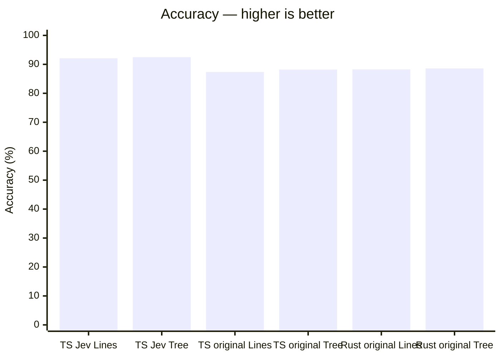
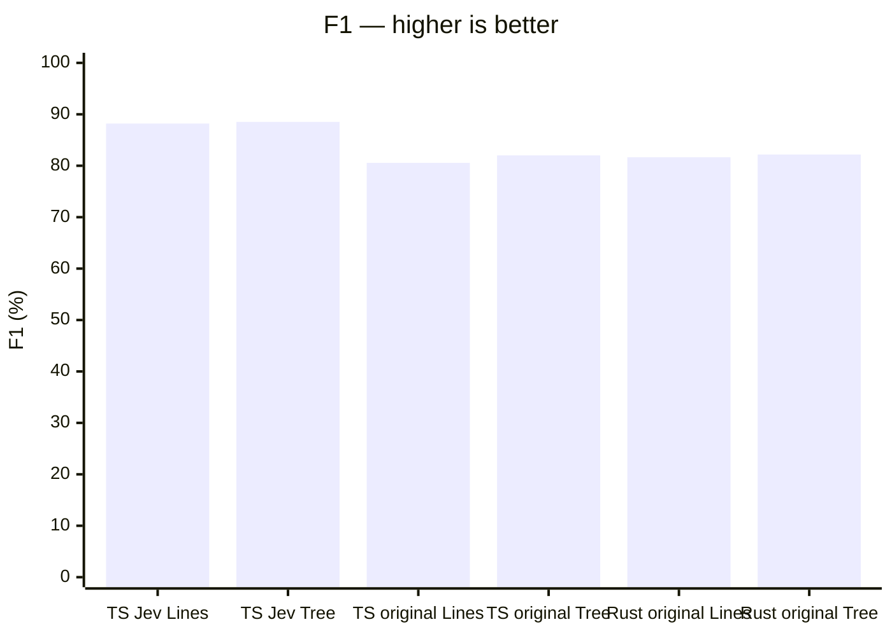
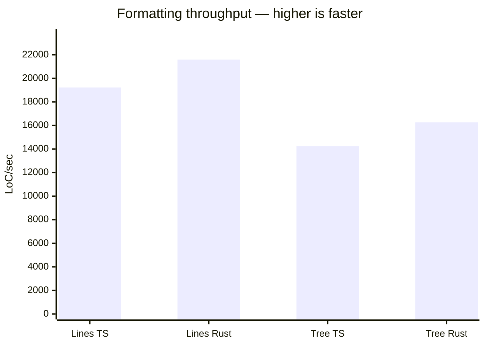
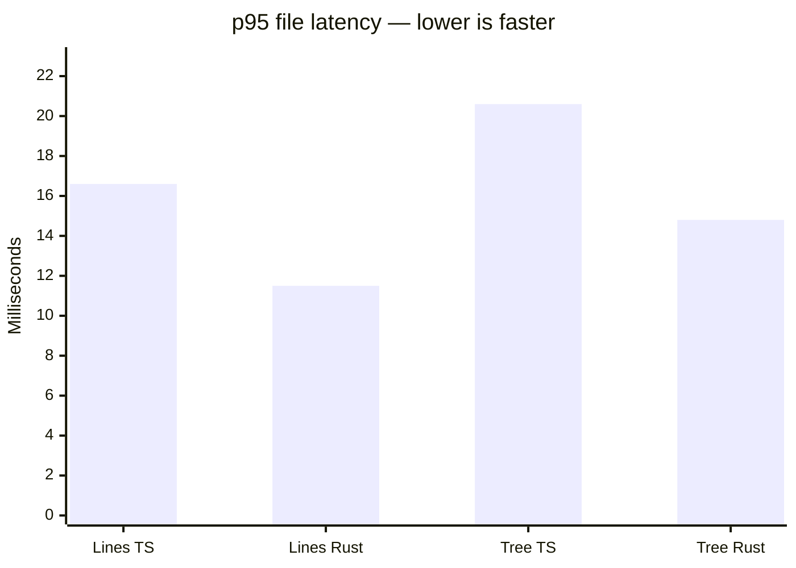
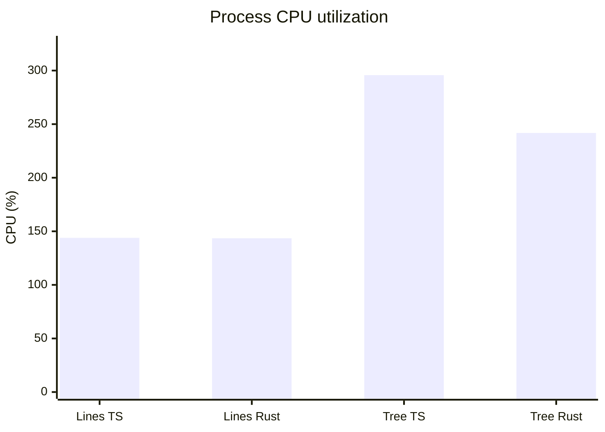
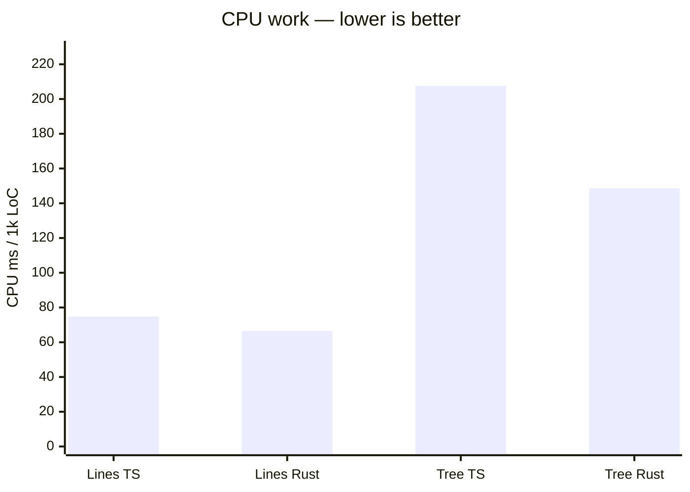
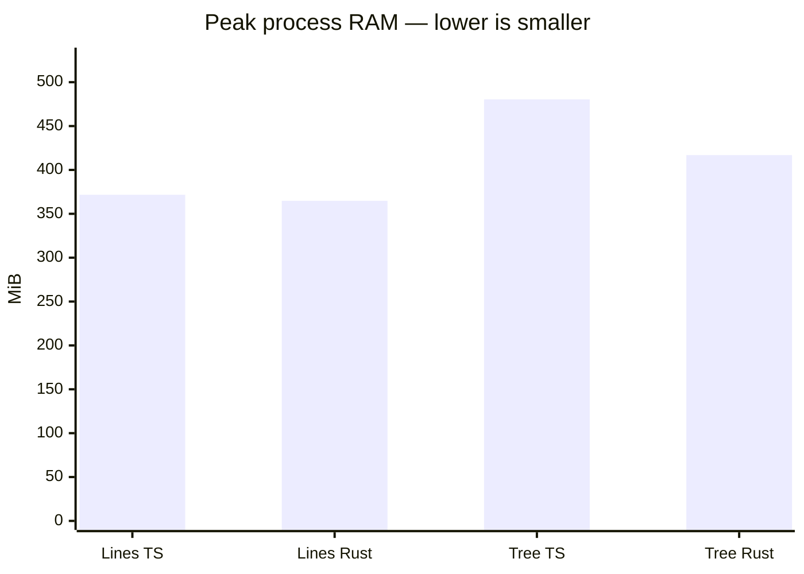
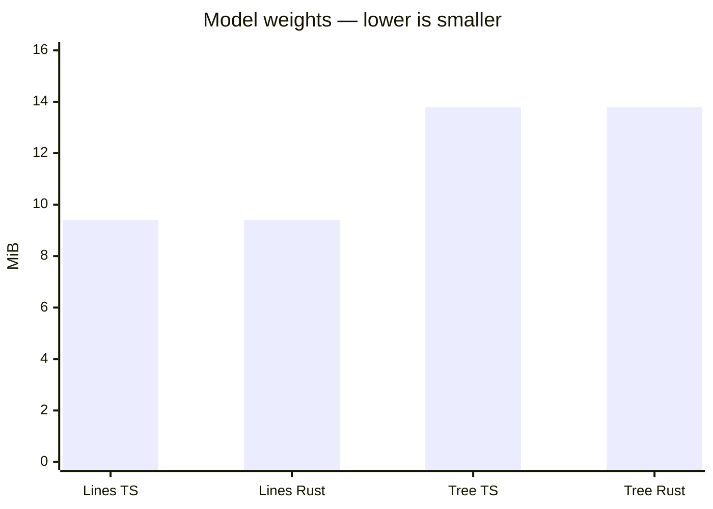
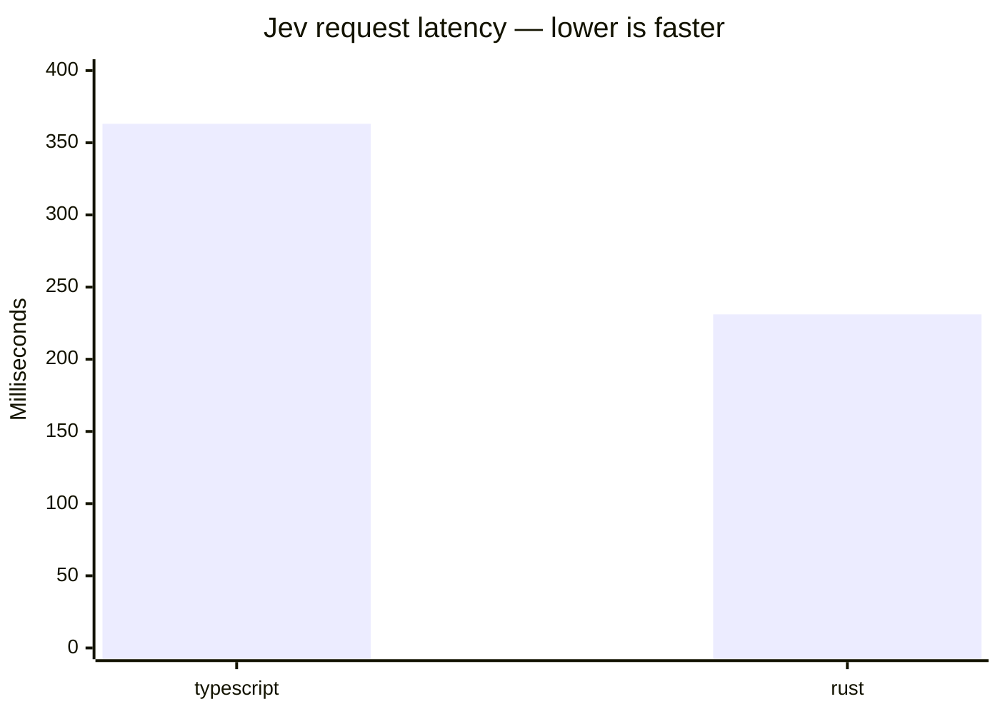
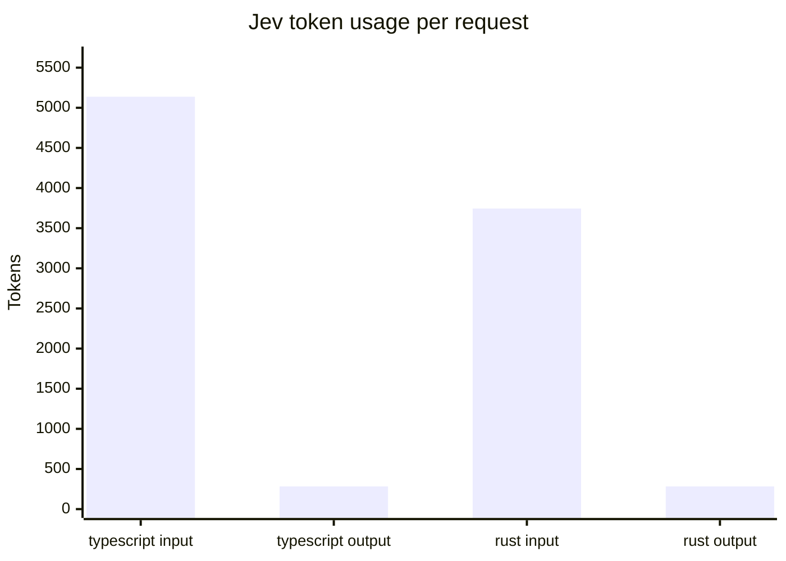

# Spacer benchmark

Updated 2026-10-19T21:54:38.780Z. **This report generation makes no Jev API calls.** Approved Jev probe results are reused from the persistent cache below.

## Accuracy by language and label source

These are **corpus-specific trained checkpoints**, not one universal checkpoint evaluated against both styles. See checkpoint mapping below. Accuracy is binary blank-line agreement at admitted boundaries, not whole-file correctness.

| Model family                | TS: Jev-prepared corpus — test | TS: original source — validation | Rust: original source — validation |
| --------------------------- | -----------------------------: | -------------------------------: | ---------------------------------: |
| Lines                       |                         92.11% |                           87.38% |                             88.27% |
| Tree-Sitter cross-attention |                     **92.49%** |                       **88.20%** |                         **88.59%** |



Chart labels use **Tree** for cross-attention; **Jev** and **original** identify the label source. Missing measurements are omitted, not plotted as zero.

| Model family                | TS Jev test F1 | TS original validation F1 | Rust original validation F1 |
| --------------------------- | -------------: | ------------------------: | --------------------------: |
| Lines                       |         88.20% |                    80.56% |                      81.65% |
| Tree-Sitter cross-attention |         88.52% |                    82.01% |                      82.18% |



Original-source advantages: **+0.83 percentage points TS**, **+0.32 points Rust**. Original-source figures are validation results, not confirmed held-out performance. Jev-trained models' scores on original-source labels, and original-trained models' scores on Jev labels, have not been measured here.

## CPU formatting performance and resource use

Measured with the **currently deployed Jev-trained playground checkpoints** for both languages. These measurements do not claim to benchmark the three newly trained original-source checkpoints. They establish the runtime comparison available in the playground today.

| Model                       | Input language | LoC/sec ↑ | p95 file ms ↓ | CPU %¹ | CPU ms / 1k LoC ↓ | Peak RAM MiB² | Weights MiB |
| --------------------------- | -------------- | --------: | ------------: | -----: | ----------------: | ------------: | ----------: |
| Lines                       | TS             |    19,227 |          16.6 |  143.9 |              74.8 |         371.7 |        9.41 |
| Lines                       | Rust           |    21,589 |          11.5 |  143.5 |              66.5 |         364.8 |        9.41 |
| Tree-Sitter cross-attention | TS             |    14,242 |          20.6 |  295.7 |             207.6 |         480.4 |       13.79 |
| Tree-Sitter cross-attention | Rust           |    16,272 |          14.8 |  241.8 |             148.6 |         416.9 |       13.79 |













¹ Process CPU time divided by wall time: **100% = one fully occupied logical CPU**, and multi-threaded use can exceed 100%. Includes parser workers/native inference threads; excludes other machine processes. CPU ms/1k LoC measures total CPU work.

² Peak process RSS from process startup through the benchmark, including Node, TensorFlow, parser workers, model and temporary allocations. It is **not** model-only RAM or GPU VRAM. Separate subprocesses prevent previous models contaminating the peak. Raw results also record post-warmup RSS.

Original-trained parameter payload sizes: Lines TS and Rust each **9.41 MiB**, mixed cross-attention **13.79 MiB**, calculated as FP32 parameters × 4 bytes. Checkpoint/container overhead and optimizer state are excluded. Deployed weights sizes above are measured binary file sizes.

## Methodology and checkpoint mapping

- **Jev-prepared TS accuracy:** existing frozen evaluation on 722,143 identical test boundaries. Lines is the deployed historical model (threshold 0.41); Tree is cross-attention seed 42 (0.50). The stronger retrained Lines control scored 92.22%, versus Tree's 92.49%. No test reopening or calibration in this report.
- **Original-source accuracy:** saved full validation metrics on 2,739,595 TS and 1,283,192 Rust examples. Lines uses separate language-specific seed-42 models (thresholds 0.54 TS, 0.545 Rust); Tree uses one mixed TS/Rust seed-42 model (global threshold 0.52). These checkpoints were selected on validation loss and calibrated on validation accuracy. No new held-out evaluation was run.
- Both datasets use file-group splits targeting 70/15/15 and common model-comparison membership. Exact truncated lexical contexts are deduplicated train-first. Bundled grammars rejected 1,842 teacher source files and 12,306 original-source files; coverage is restricted to admitted inputs. The split is file-group based, not repository-disjoint.
- Teacher labels come from existing Jev-prepared after-states; original labels come from unchanged upstream whitespace. They measure different style targets. No new teacher calls, no self-generated Jev score, and no invented Rust teacher results.
- Tree is a **lexical–Tree-sitter hybrid**, combining BPE and compact syntax-ID streams with cross-attention. Lines is also token-based (line-wise BPE). Original-trained Tree sees both languages, whereas each original-trained Lines model sees only its language; this is a deployment comparison, not a controlled architecture-only ablation.
- **Performance workload:** pinned shared playground excerpts: VS Code fuzzy scoring for TS, ripgrep processing for Rust. One file per language, 255 TS LoC and 199 Rust LoC after removing original spacing. These are a small illustrative workload, not a representative repository-wide speed estimate or accuracy dataset. Both models receive identical input per language.
- One warm-up and 20 measured sequential full-format runs per model/language. Throughput = total input LoC / total wall time; p95 is nearest-rank file latency. Includes Tree-sitter preparation, model tokenization/scoring, and syntax-checked rendering. Excludes model loading, file I/O and HTTP. No code reformatter runs.
- CPU runtime: TensorFlow.js Node 4.22.0; AMD Ryzen 9 9950X 16-Core Processor; 32 logical CPUs; Node v26.12.0. Default thread pools: intra 8, inter 2, OMP 8. Shared-machine activity can affect timings; GPU training performance is not being conflated with CPU inference.
- Deployed artifacts: `tmp/spacer-lines-ts` and `tmp/spacer-tree-sitter-cross-attention-1`. Original-trained artifacts: `tmp/research-v2-original-gpu/{lines-typescript,lines-rust,cross-attention-mixed}-seed42`.

## Reproduce and approval boundary

```sh
mise benchmark
```

Requires the local model exports, saved evaluation/config files, and pinned example catalog. This command makes **no network/API calls** and does not train, recalibrate, or reopen test data. It preserves the previous report and timestamped raw metrics before replacing this document.

Raw results, input/model hashes, individual timings, and source metrics: [results.json](../docs/benchmark-data/runs/2026-10-19T21-54-38.780Z-summary/results.json).

**Further evaluation:** full-file or corpus-wide Jev testing requires a separate budget. Rust corpus teacher labels do not currently exist. No paid testing starts from this benchmark task.

### Completed Jev economical probe

Saved provider responses, reused without additional API calls:

| Language   | Model      | Boundaries | Request latency ms | Input tokens | Output tokens |
| ---------- | ---------- | ---------: | -----------------: | -----------: | ------------: |
| typescript | jev-1.13.0 |         16 |              363.1 |         5138 |           282 |
| rust       | jev-1.13.0 |         16 |              231.1 |         3745 |           282 |





One request per language; latency includes the API round trip. This sampled-boundary probe does not establish full-file LoC/sec or corpus accuracy. Provider CPU/RAM and weights are unavailable. Unavailable Jev metrics are omitted from the main tables. Original timestamps and probabilities are in [cached results](benchmark-data/jev/results.json).

### Economical Jev probe

Run `mise run benchmark:jev` for a network-free plan and reuse of stored results. It samples up to 16 evenly distributed boundaries from each of the same TS/Rust excerpts (32 questions, at most two requests). No warm-up or repeats. This is a boundary probe, **not full-file LoC/sec or corpus accuracy**; the tables above remain unchanged until comparable measurements exist.

The [plan](benchmark-data/jev/plan.json) lists exact prompts and estimated uncached tokens; [results](benchmark-data/jev/results.json) retains responses, provider token usage, model identity and original latency. See [cache methodology](benchmark-data/jev/README.md). These JSON files and future benchmark runs live in tracked `docs/benchmark-data/`, rather than ignored `reports/`.

Only after approval: `mise run benchmark:jev -- --execute --model <approved-model> --max-estimated-tokens 16000`. The estimate is a tokenizer proxy, not a provider-side hard cap. Retries are disabled; identical cached requests cost zero tokens. Adding local models does not invalidate Jev responses. The default alias is frozen by caching its first response; choose a new explicit model identifier to request a new model evaluation.
