# Spacer benchmark

Updated 2026-10-23T02:37:42.681Z. **This report generation makes no Jev API calls.** Approved Jev probe results are reused from the persistent cache below.

## Sequential cross-attention — surrounding spacing and all-line boundaries

**New playground release:** Spacer Sequential Cross-Attention v1 Rust + TypeScript (`spacer-tree-sitter-spacing-context-1`). One 3,613,761-parameter bilingual model, trained from scratch on **64,039,150 boundaries**. Training stopped after 12 epochs; epoch 5 was selected by minimum validation loss. The frozen shared threshold is **0.47**.

At each safe inter-line gap, the model hides the entire current gap, retains internal blank lines in the five-nonempty-line context blocks, and predicts top-to-bottom. Earlier model decisions become context for later predictions; future context keeps its input spacing. Protected literal/comment interiors remain untouched. This trained behavior is always enabled, independently of the playground's experimental checkbox for older models.

**Sequential validation, not a new held-out test:** 100 TS and 100 Rust validation files selected deterministically by file hash, restricted to 1–512 eligible boundaries/file. The same files and original labels are used in both conditions. “Stripped” removes blank lines only at eligible gaps before formatting; protected content stays intact.

| Input condition | Language | Boundaries | Accuracy | F1 | Precision | Recall |
| --- | --- | ---: | ---: | ---: | ---: | ---: |
| Original spacing | TS | 9,502 | 96.35% | 84.38% | 88.65% | 80.50% |
| Original spacing | Rust | 9,682 | 97.26% | 87.92% | 94.05% | 82.53% |
| Eligible gaps stripped | TS | 9,502 | 95.30% | 78.62% | 88.67% | 70.62% |
| Eligible gaps stripped | Rust | 9,682 | 96.91% | 86.07% | 94.38% | 79.11% |

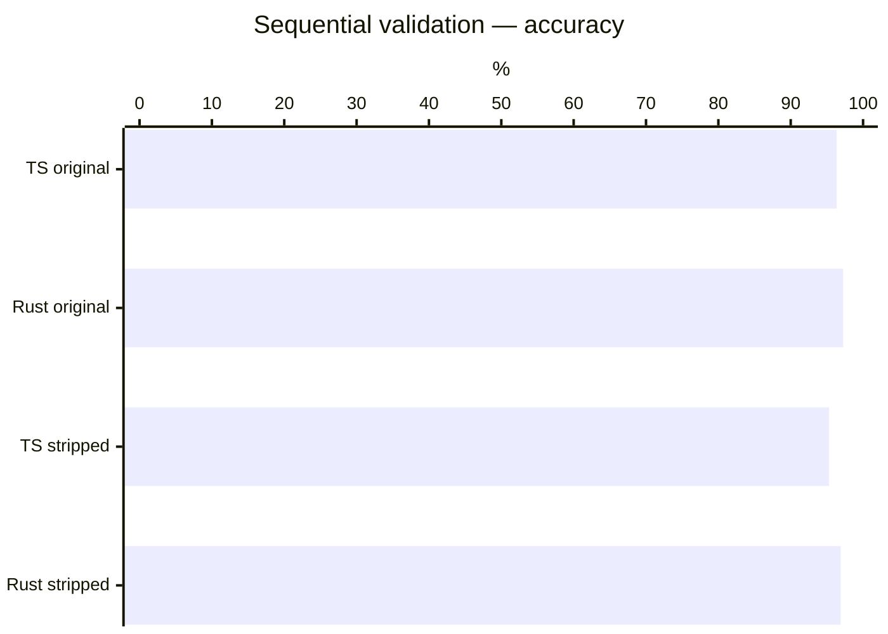

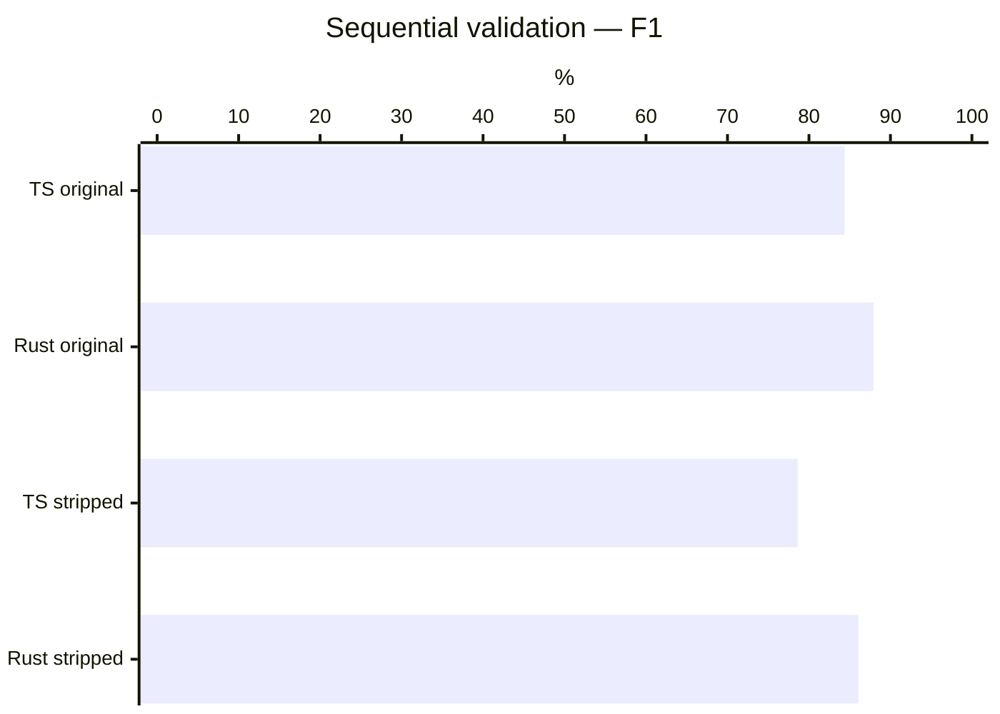

Surrounding spacing helps on this sample, particularly TS: F1 falls from **84.38% to 78.62%** when eligible input gaps are stripped (Rust: **87.92% to 86.07%**). This is not a controlled comparison against the earlier architecture/checkpoints. Many newly admitted gaps correctly need no blank line, so the ~96–97% accuracy **must not be compared directly with the older ~88% sibling-boundary results**.

Full teacher-forced validation uses original surrounding context rather than previous model decisions: **13,331,614 boundaries**, **96.37% accuracy / 82.53% F1** overall. Per-language accuracy/F1: **96.28% / 82.72% TS**, **96.54% / 82.12% Rust**. These are separate measurements from the sequential sample above.

Release: `spacer-models/models/tree-sitter-spacing-context-1/`. Export parity passed (maximum probability difference **2.69×10⁻⁷**). [Bucket read-back verification](benchmark-data/spacing-context-v1/release-verification.json), [training history](benchmark-data/spacing-context-v1/training.json), [sequential results](benchmark-data/spacing-context-v1/sequential-validation.json), [protocol](research/spacing-context-v1.md). The legacy test partition was not reopened by this campaign.


**Earlier bilingual comparison:** Lines trades a small held-out accuracy loss for faster full-file formatting on the pinned examples. **TS: 1.55× cross-attention throughput** (11,418 vs 7,366 LoC/sec); **Rust: 1.48× cross-attention throughput** (10,932 vs 7,378 LoC/sec). Its frozen held-out accuracy is **88.03% TS / 88.45% Rust**, versus **88.46% / 88.68%** for the original-trained cross-attention control. Speed now uses expanded playground boundaries; the held-out accuracy below retains its original sibling-boundary scope.

## Bilingual original-source models — held-out test

One model trained from scratch on both Rust and TypeScript. Architecture and seed-42 primary were selected on validation and frozen before this one-shot evaluation; seed 123 is confirmation, not a replacement selected on test. All four models use identical admitted test boundaries: **4,087,878**, including **2,801,959 TS** and **1,285,919 Rust**. One validation-calibrated threshold per model, with no test-time retuning.

| Model | TS accuracy | Rust accuracy | TS F1 | Rust F1 | TS log loss | Rust log loss |
| --- | ---: | ---: | ---: | ---: | ---: | ---: |
| Bilingual Lines baseline | 87.75% | 88.23% | 81.04% | 81.48% | 0.28729 | 0.27582 |
| Bilingual Lines selected (seed 42) | 88.03% | 88.45% | 81.57% | 81.90% | 0.28010 | 0.26929 |
| Bilingual Lines confirmation (seed 123) | 88.16% | 88.45% | 81.90% | 81.97% | 0.28119 | 0.27243 |
| Cross-attention original-trained | 88.46% | 88.68% | 82.39% | 82.24% | 0.27225 | 0.26357 |

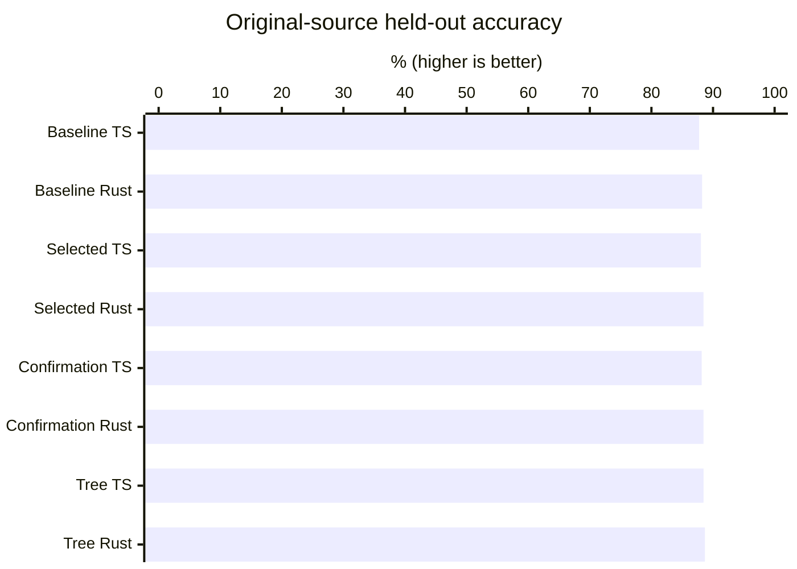

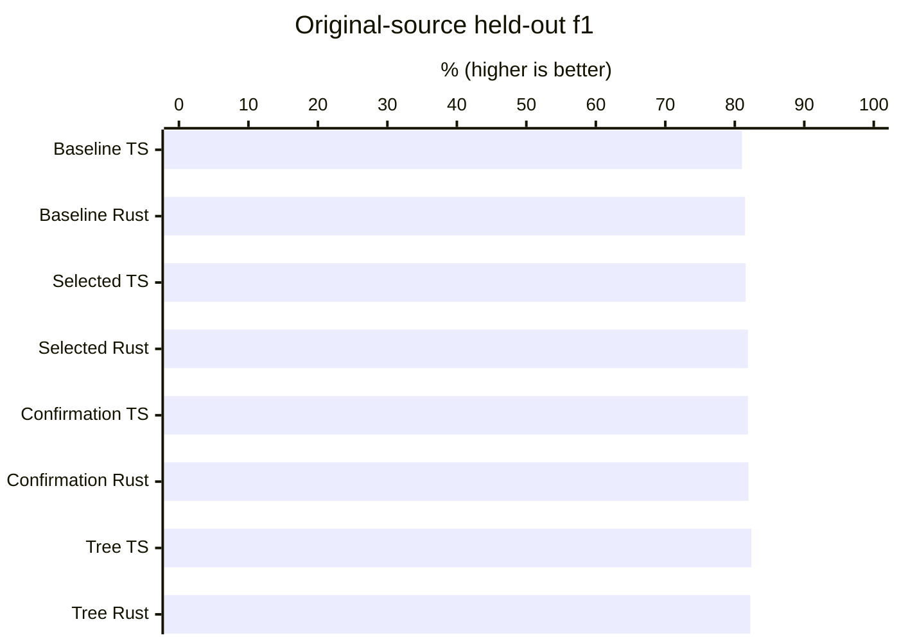

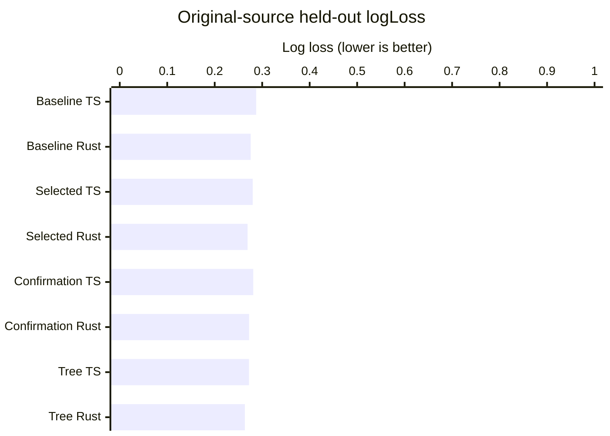

Selected Lines minus cross-attention: **-0.43 percentage points TS**, **-0.24 points Rust**. The speed/accuracy tradeoff must be judged using the full-file measurements below, not scoring-only throughput. [Frozen plan](benchmark-data/lines-mixed-v1/held-out-plan.json), [held-out results and paired correctness counts](benchmark-data/lines-mixed-v1/held-out.json), [training protocol](research/lines-mixed-v1.md).

## Earlier accuracy by language and label source

These are **corpus-specific trained checkpoints**, not one universal checkpoint evaluated against both styles. See checkpoint mapping below. Accuracy is binary blank-line agreement at admitted boundaries, not whole-file correctness.

| Model family | TS: Jev-prepared corpus — test | TS: original source — validation | Rust: original source — validation |
| --- | ---: | ---: | ---: |
| Lines | 92.11% | 87.38% | 88.27% |
| Tree-Sitter cross-attention | **92.49%** | **88.20%** | **88.59%** |

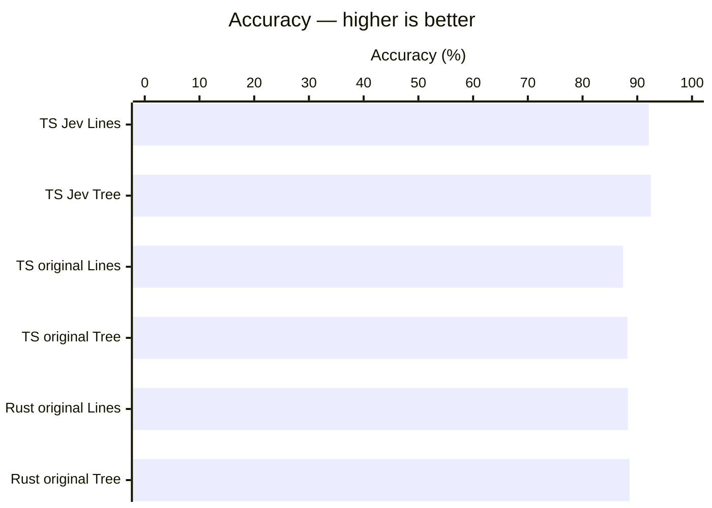

Chart labels use **Tree** for cross-attention; **Jev** and **original** identify the label source. Missing measurements are omitted, not plotted as zero.

| Model family | TS Jev test F1 | TS original validation F1 | Rust original validation F1 |
| --- | ---: | ---: | ---: |
| Lines | 88.20% | 80.56% | 81.65% |
| Tree-Sitter cross-attention | 88.52% | 82.01% | 82.18% |

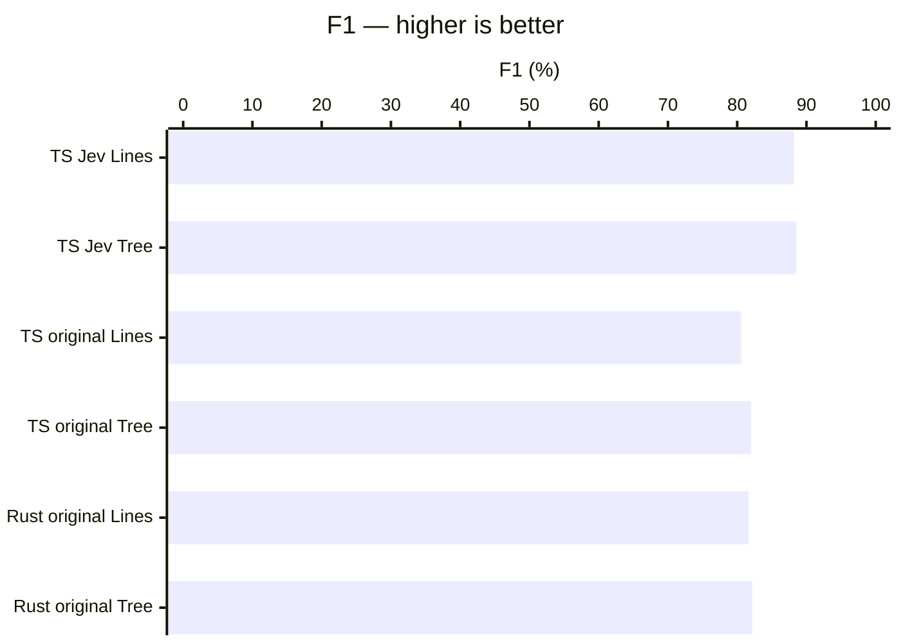

Earlier cross-attention advantages over language-specific Lines: **+0.83 percentage points TS**, **+0.32 points Rust**. Original-source figures in these two historical tables are validation results; the bilingual held-out comparison is above. Jev-trained models' scores on original-source labels, and original-trained models' scores on Jev labels, have not been measured here.

## CPU formatting performance and resource use

Measured with the historical Jev-trained checkpoints, original-trained bilingual Lines/cross-attention, and the new sequential model. **All use the current playground's expanded safe inter-line boundaries** on the same inputs. Older models score independently with stripped lexical context; the new model scores top-to-bottom with spacing feedback. These timings replace the older sibling-only workload and should not be treated as a runtime regression at fixed boundary coverage. All listed models are available in the playground and published to R2.

| Model | Input language | LoC/sec ↑ | p95 file ms ↓ | CPU %¹ | CPU ms / 1k LoC ↓ | Peak RAM MiB² | Weights MiB |
| --- | --- | ---: | ---: | ---: | ---: | ---: | ---: |
| Lines (Jev-trained) | TS | 13,878 | 21.5 | 152.5 | 109.9 | 381.1 | 9.41 |
| Lines (Jev-trained) | Rust | 13,778 | 19.5 | 154.9 | 112.4 | 370.1 | 9.41 |
| Cross-attention (Jev-trained) | TS | 7,673 | 36.5 | 410.4 | 534.9 | 534.1 | 13.79 |
| Cross-attention (Jev-trained) | Rust | 7,556 | 30.5 | 398.4 | 527.2 | 539.6 | 13.79 |
| Bilingual Lines (original-trained) | TS | 11,418 | 25.9 | 189.8 | 166.2 | 397.7 | 13.51 |
| Bilingual Lines (original-trained) | Rust | 10,932 | 23.3 | 193.9 | 177.4 | 396.0 | 13.51 |
| Cross-attention (original-trained) | TS | 7,366 | 42.3 | 408.6 | 554.7 | 531.8 | 13.79 |
| Cross-attention (original-trained) | Rust | 7,378 | 30.9 | 396.9 | 538.0 | 540.0 | 13.79 |
| Sequential Tree | TS | 1,365 | 198.7 | 135.8 | 995.1 | 432.0 | 13.79 |
| Sequential Tree | Rust | 1,328 | 161.7 | 142.1 | 1070.1 | 407.4 | 13.79 |

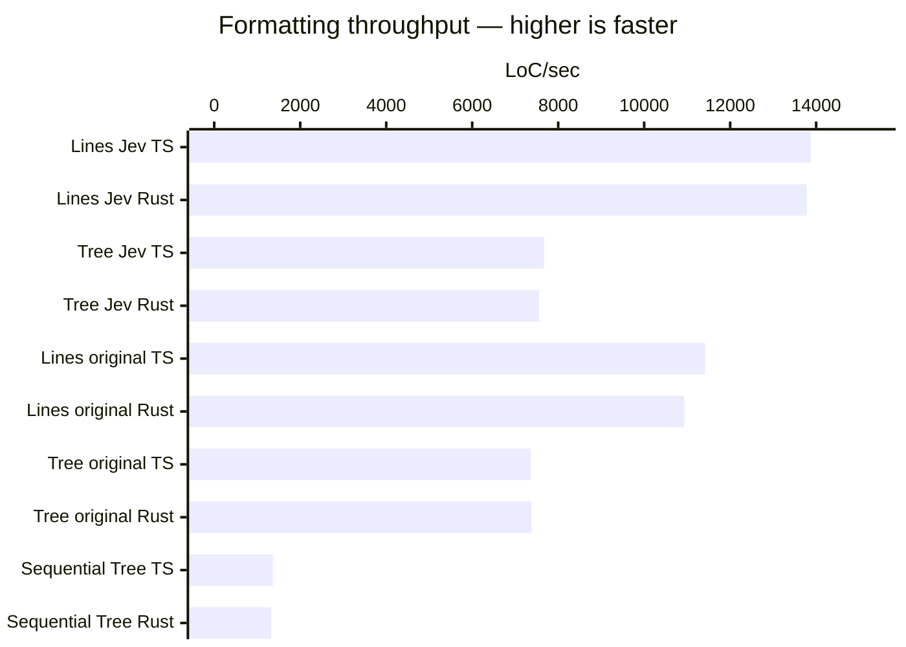

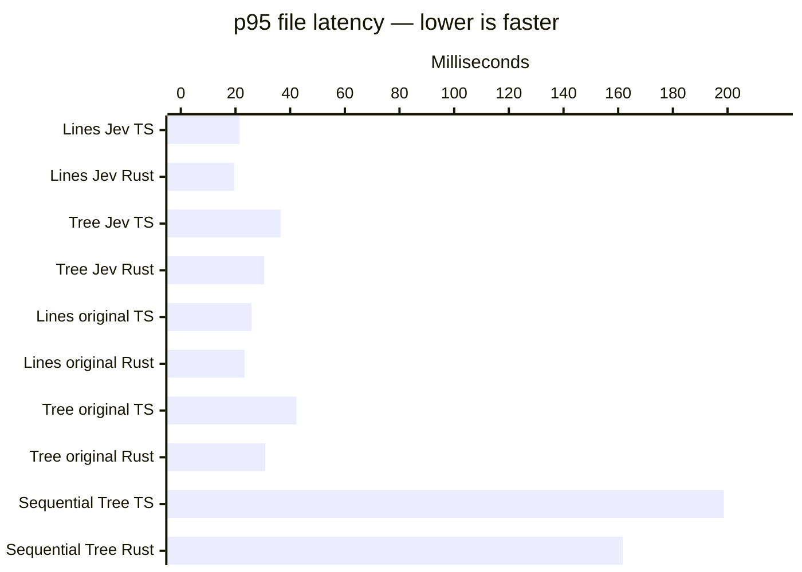

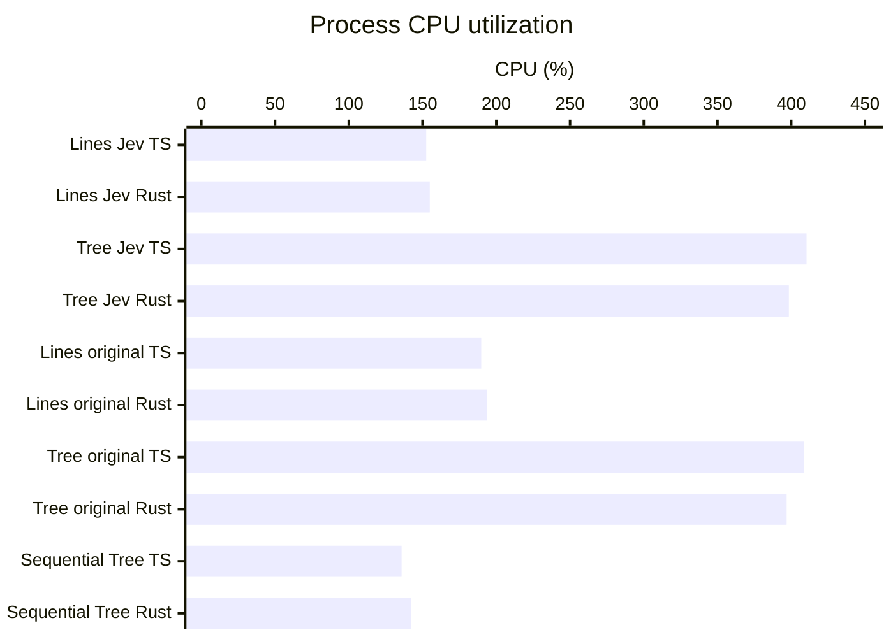

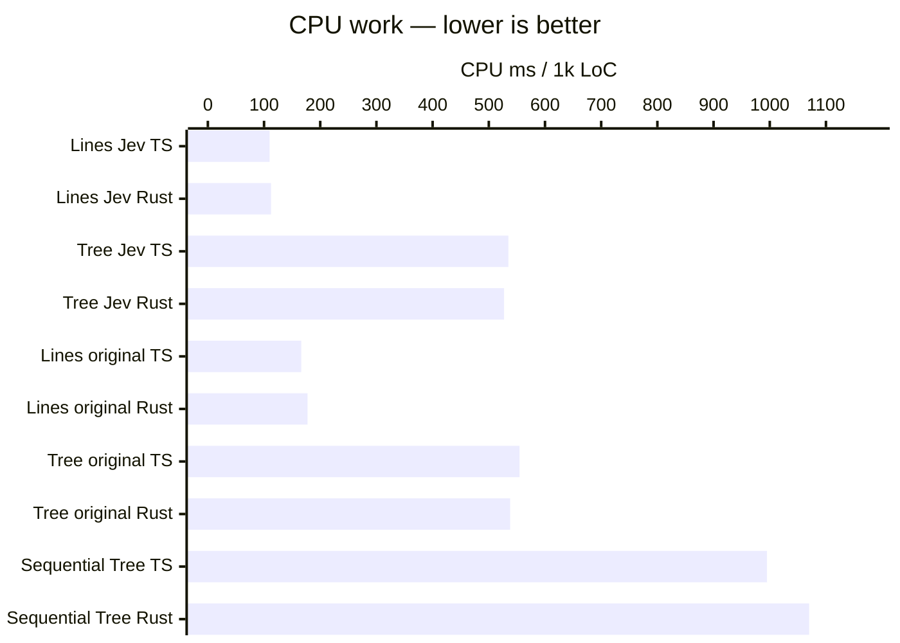

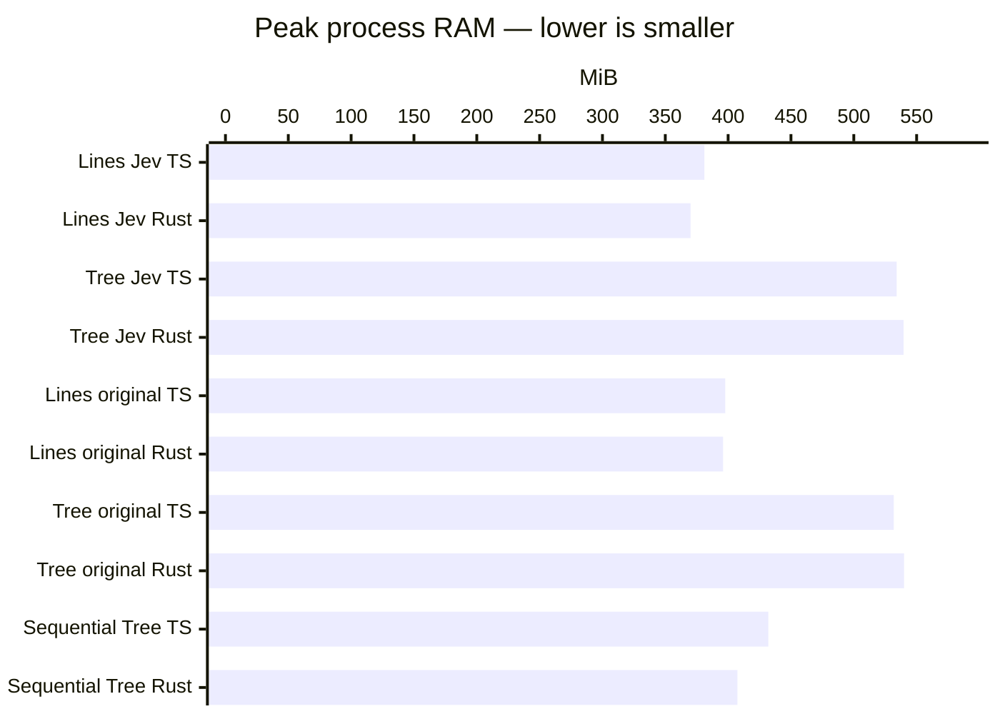

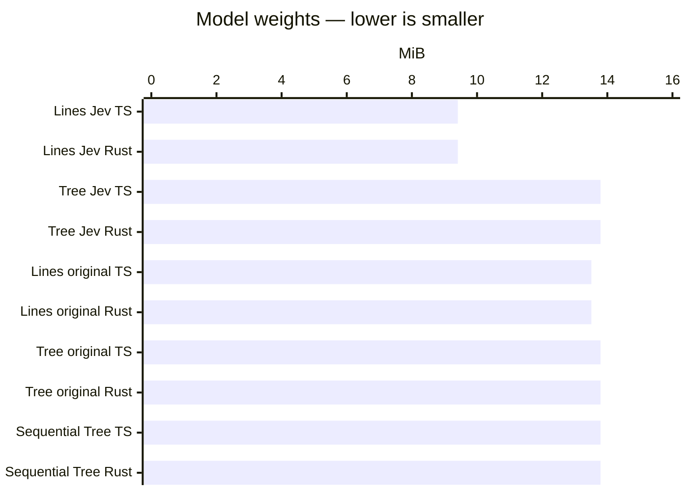

¹ Process CPU time divided by wall time: **100% = one fully occupied logical CPU**, and multi-threaded use can exceed 100%. Includes parser workers/native inference threads; excludes other machine processes. CPU ms/1k LoC measures total CPU work.

² Peak process RSS from process startup through the benchmark, including Node, TensorFlow, parser workers, model and temporary allocations. It is **not** model-only RAM or GPU VRAM. Separate subprocesses prevent previous models contaminating the peak. Raw results also record post-warmup RSS.

Original-trained matched full-file comparison: **TS: 1.55× cross-attention throughput** (11,418 vs 7,366 LoC/sec); **Rust: 1.48× cross-attention throughput** (10,932 vs 7,378 LoC/sec). Ratios above 1 mean Lines is faster; below 1 mean cross-attention is faster. These two short examples establish neither repository-wide throughput nor a universal speedup.

The new playground model is **Spacer Lines v1 Rust + TypeScript** (`spacer-lines-mixed-1`). Its release lives at `spacer-models/models/lines-mixed-1/`; [all five objects were read-back verified](benchmark-data/lines-mixed-v1/release-verification.json). PyTorch/TFJS export parity passed with maximum probability error 2.4×10⁻⁷, and both languages passed blank-line-only formatting checks.

Original-trained parameter payload sizes: Lines TS and Rust each **9.41 MiB**, mixed cross-attention **13.79 MiB**, calculated as FP32 parameters × 4 bytes. Checkpoint/container overhead and optimizer state are excluded. Deployed weights sizes above are measured binary file sizes.


## CPU model scoring only — separate from formatting

Saved PyTorch FP32 results from the completed search: eight CPU threads, matched real validation inputs per language, one warm-up and 20 repeats, median throughput. Batch 1 uses 128 boundaries; batch 512 uses 8,192 boundaries. **Excludes parsing, tokenization and rendering; boundaries/sec is not LoC/sec.** The context-small candidate remains a validation-search result, not a test-selected deployment alternative.

| Model | TS batch 1 boundaries/s | Rust batch 1 boundaries/s | TS batch 512 boundaries/s | Rust batch 512 boundaries/s |
| --- | ---: | ---: | ---: | ---: |
| Lines baseline | 20,271 | 19,310 | 213,805 | 197,272 |
| Lines context-small | 14,687 | 14,959 | 165,452 | 165,077 |
| Lines selected | 8,852 | 9,145 | 64,699 | 62,277 |
| Cross-attention | 6,888 | 7,749 | 9,282 | 9,035 |

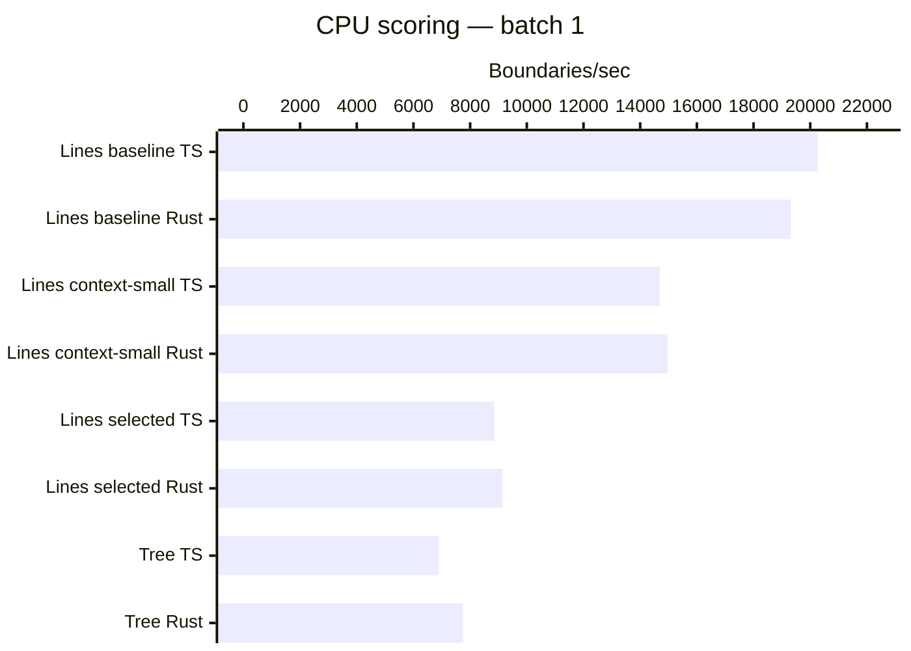

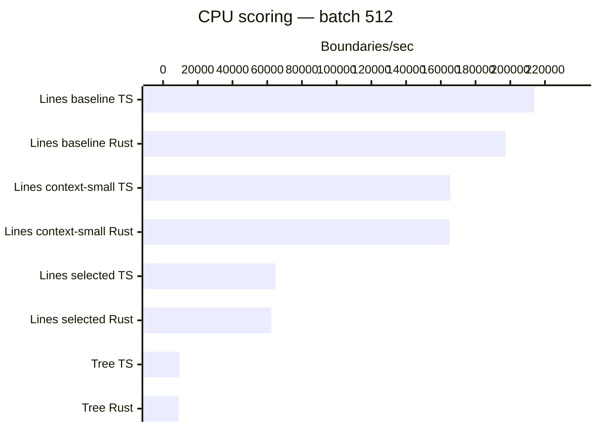

[All scoring timings](benchmark-data/lines-mixed-v1/performance.json). The roughly 7× batched PyTorch scoring advantage must not be presented as a 7× end-to-end formatting gain.

## Methodology and checkpoint mapping

- **Jev-prepared TS accuracy:** existing frozen evaluation on 722,143 identical test boundaries. Lines is the deployed historical model (threshold 0.41); Tree is cross-attention seed 42 (0.50). The stronger retrained Lines control scored 92.22%, versus Tree's 92.49%. No test reopening or calibration in this report.
- **Earlier original-source validation:** saved metrics on 2,739,595 TS and 1,283,192 Rust examples. The historical Lines row uses separate language-specific seed-42 models (thresholds 0.54 TS, 0.545 Rust); Tree uses one mixed TS/Rust seed-42 model (global threshold 0.52).
- **New bilingual held-out evaluation:** selected Lines seed 42 threshold 0.52, baseline 0.505, confirmation seed 123 threshold 0.515, original-trained Tree 0.52. All trained on the same mixed 19,454,891 boundaries. Checkpoints minimize validation loss; thresholds maximize validation accuracy with F1 tie-break. Architecture selection uses macro-language validation accuracy. The held-out evaluation is frozen, CPU FP32, resumable only with identical hashes, and cached separately from this report generator. No post-test selection or training.
- Both datasets use file-group splits targeting 70/15/15 and common model-comparison membership. Exact truncated lexical contexts are deduplicated train-first. Bundled grammars rejected 1,842 teacher source files and 12,306 original-source files; coverage is restricted to admitted inputs. The split is file-group based, not repository-disjoint.
- Teacher labels come from existing Jev-prepared after-states; original labels come from unchanged upstream whitespace. They measure different style targets. No new teacher calls, no self-generated Jev score, and no invented Rust teacher results.
- Tree is a **lexical–Tree-sitter hybrid**, combining BPE and compact syntax-ID streams with cross-attention. Lines is also token-based (line-wise BPE). The new bilingual Lines and original-trained Tree both see both languages; only the historical language-specific Lines controls see one language each. Neither blank lines nor language IDs enter the new Lines model.
- **Performance workload:** pinned shared playground excerpts: VS Code fuzzy scoring for TS, ripgrep processing for Rust. One file per language, 255 TS LoC and 199 Rust LoC after removing original spacing. These are a small illustrative workload, not a representative repository-wide speed estimate or accuracy dataset. Both models receive identical input per language.
- One warm-up and 20 measured sequential full-format runs per model/language. Throughput = total input LoC / total wall time; p95 is nearest-rank file latency. Includes Tree-sitter preparation, model tokenization/scoring, and syntax-checked rendering. Excludes model loading, file I/O and HTTP. No code reformatter runs.
- CPU runtime: TensorFlow.js Node 4.22.0; AMD Ryzen 9 9950X 16-Core Processor; 32 logical CPUs; Node v26.12.1. Default thread pools: intra 8, inter 2, OMP 8. Shared-machine activity can affect timings; GPU training performance is not being conflated with CPU inference.
- Historical deployed artifacts: `tmp/spacer-lines-ts` and `tmp/spacer-tree-sitter-cross-attention-1`. New bilingual export: `tmp/spacer-lines-mixed-1`, from `tmp/lines-mixed-v1/context-dilated-seed42`. Original-trained attention control export: `tmp/spacer-tree-sitter-cross-attention-original-1`. Source training checkpoints: `tmp/research-v2-original-gpu/{lines-typescript,lines-rust,cross-attention-mixed}-seed42`.

## Reproduce and approval boundary

```sh
mise benchmark
```

Requires the local model exports, saved evaluation/config files, and pinned example catalog. This command makes **no network/API calls** and does not train, recalibrate, or reopen test data. It preserves the previous report and timestamped raw metrics before replacing this document.

Raw results, input/model hashes, individual timings, and source metrics: [results.json](../docs/benchmark-data/runs/2026-10-23T02-37-42.681Z-summary/results.json).

**Further evaluation:** full-file or corpus-wide Jev testing requires a separate budget. Rust corpus teacher labels do not currently exist. No paid testing starts from this benchmark task.

### Completed Jev economical probe

Saved provider responses, reused without additional API calls:

| Language | Model | Boundaries | Request latency ms | Input tokens | Output tokens |
| --- | --- | ---: | ---: | ---: | ---: |
| typescript | jev-1.13.0 | 16 | 363.1 | 5138 | 282 |
| rust | jev-1.13.0 | 16 | 231.1 | 3745 | 282 |

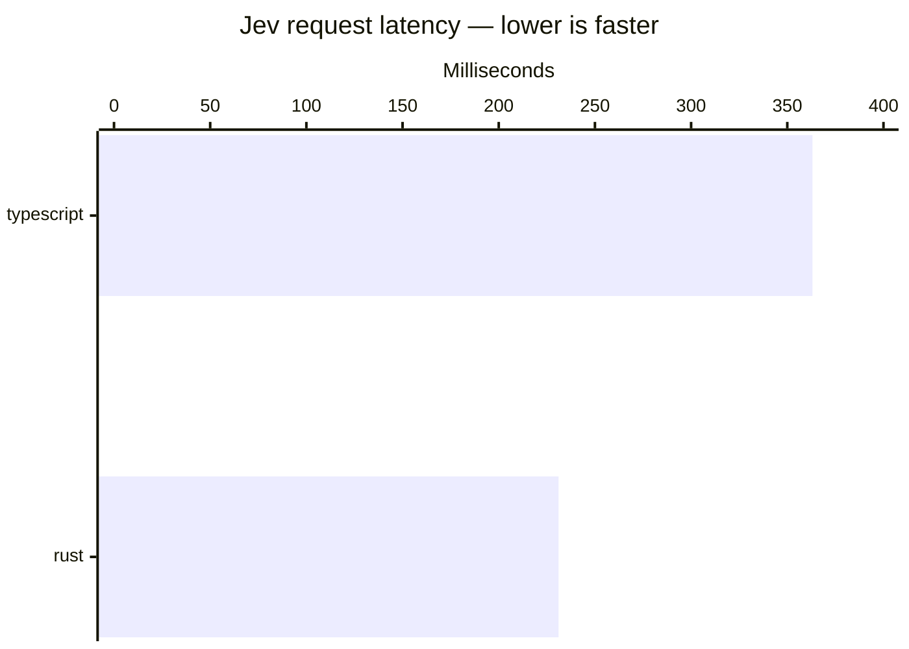

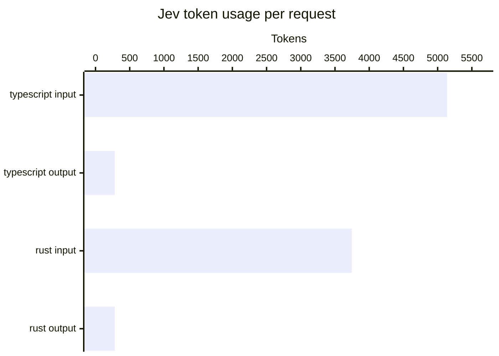

One request per language; latency includes the API round trip. This sampled-boundary probe does not establish full-file LoC/sec or corpus accuracy. Provider CPU/RAM and weights are unavailable. Unavailable Jev metrics are omitted from the main tables. Original timestamps and probabilities are in [cached results](benchmark-data/jev/results.json).


### Economical Jev probe

Run `mise run benchmark:jev` for a network-free plan and reuse of stored results. It samples up to 16 evenly distributed boundaries from each of the same TS/Rust excerpts (32 questions, at most two requests). No warm-up or repeats. This is a boundary probe, **not full-file LoC/sec or corpus accuracy**; the tables above remain unchanged until comparable measurements exist.

The [plan](benchmark-data/jev/plan.json) lists exact prompts and estimated uncached tokens; [results](benchmark-data/jev/results.json) retains responses, provider token usage, model identity and original latency. See [cache methodology](benchmark-data/jev/README.md). These JSON files and future benchmark runs live in tracked `docs/benchmark-data/`, rather than ignored `reports/`.

Only after approval: `mise run benchmark:jev -- --execute --model <approved-model> --max-estimated-tokens 16000`. The estimate is a tokenizer proxy, not a provider-side hard cap. Retries are disabled; identical cached requests cost zero tokens. Adding local models does not invalidate Jev responses. The default alias is frozen by caching its first response; choose a new explicit model identifier to request a new model evaluation.
