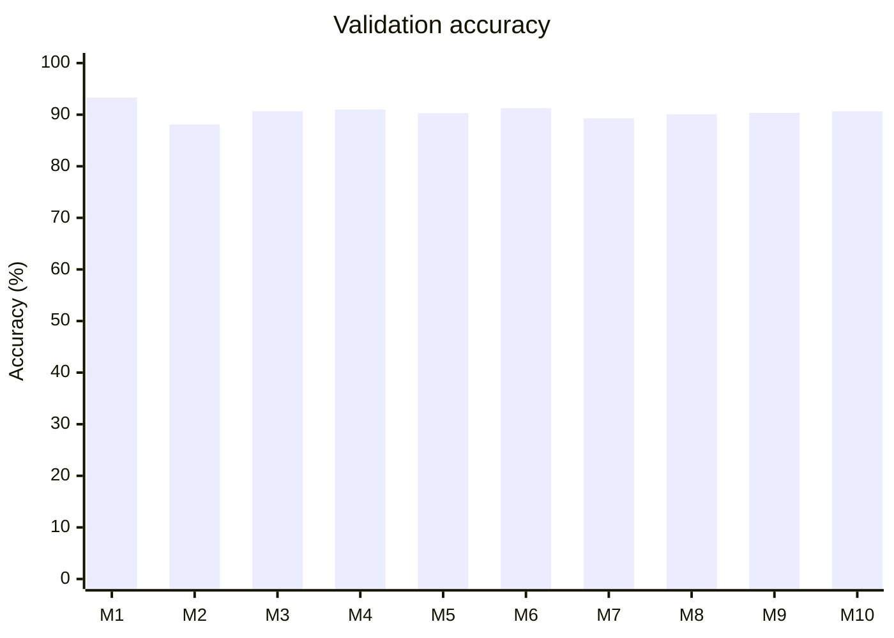
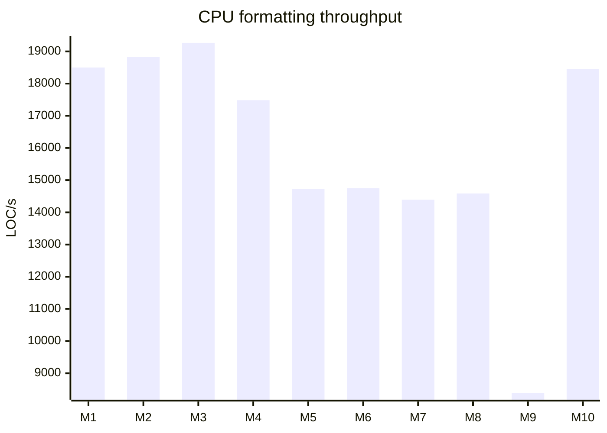

# Model benchmark

Generated 2026-10-17T02:17:54.317Z by `mise benchmark`. All 10 local catalog models; no hosted API calls.

## Results

**Validation teacher agreement, not held-out test accuracy.** 49 TypeScript/TSX files, 2,103 identical labeled boundaries. Saved thresholds; no calibration or model selection in this task.

| Chart ID | Model | Accuracy % | F1 % | Log loss | Threshold | LOC/s | p95 file ms | Load ms | Weights MiB |
| --- | --- | ---: | ---: | ---: | ---: | ---: | ---: | ---: | ---: |
| M1 | Spacer Lines v1 TypeScript | 93.30 | 89.82 | 0.1614 | 0.41 | 18,501 | 26.2 | 8.2 | 9.41 |
| M2 | Spacer Tree-Sitter Bytes v1 | 88.11 | 81.40 | 0.2426 | 0.4 | 18,833 | 26.1 | 1.0 | 0.28 |
| M3 | Spacer Tree-Sitter Bytes Long v1 | 90.68 | 85.11 | 0.2200 | 0.5 | 19,267 | 25.4 | 1.0 | 0.28 |
| M4 | Spacer Tree-Sitter Bytes Wide v1 | 91.01 | 85.74 | 0.2201 | 0.5 | 17,484 | 27.1 | 1.8 | 4.57 |
| M5 | Spacer Tree-Sitter Contextual v1 | 90.30 | 84.89 | 0.2154 | 0.5 | 14,729 | 31.4 | 5.2 | 7.78 |
| M6 | Spacer Tree-Sitter Regularized Seed42 v1 | 91.25 | 86.12 | 0.2139 | 0.5 | 14,756 | 31.6 | 5.0 | 7.78 |
| M7 | Spacer Tree-Sitter Regularized Seed123 v1 | 89.30 | 83.10 | 0.2332 | 0.5 | 14,395 | 31.1 | 5.5 | 7.78 |
| M8 | Spacer Tree-Sitter Regularized Seed2026 v1 | 90.06 | 83.81 | 0.2233 | 0.5 | 14,588 | 31.9 | 3.1 | 7.78 |
| M9 | Spacer Tree-Sitter Ensemble v1 | 90.35 | 84.86 | 0.2148 | 0.44 | 8,390 | 43.3 | 67.2 | 23.35 |
| M10 | Spacer Tree-Sitter Compact v1 | 90.63 | 85.82 | 0.2146 | 0.41 | 18,450 | 27.8 | 1.0 | 0.28 |





Chart IDs follow the table. Original-spacing baseline: **80.93% accuracy**, **66.78% F1**; always-no-blank accuracy: **67.67%**.

## Methodology

- Deterministic hash-ranked sample of 50 files from the existing file-group validation split (seed `benchmark-v1`); 1 exclusions are recorded in raw results. No test split is opened. The validation split has already informed historical training/selection.
- All models score exactly the same retained corpus examples, using their own tokenizers. Source hashes and stored context windows are verified. Accuracy preparation matches corpus normalization; no tokenizer-specific deduplication or model-dependent sample selection is applied. This sample is not directly comparable to historical full-test metrics, and encoded-context overlap across file splits is not re-filtered here.
- Accuracy measures agreement with existing teacher-derived spacing labels, not independent human judgments. Cross-language accuracy is unmeasured. The positive class is a blank line.
- Performance: 3 sequential CPU runs per model, rotating model order. Median LOC/s and load time; median of per-run nearest-rank p95 file latency. 6,373 source lines per run, including blank lines. One file warm-up per run; load and warm-up excluded from throughput.
- Full playground-style formatting: Tree-sitter parsing, model tokenization/scoring, and syntax-preserving rendering for every model, including Lines. Sources are preloaded; no disk I/O, HTTP, output writes, or oxfmt in measured formatting. Accuracy scoring time is not included. These sampled files may have different sizes; p95 is file latency, not per-boundary latency.
- CPU: AMD Ryzen 9 9950X 16-Core Processor; 32 logical CPUs; linux/x64; Node v26.10.0; TensorFlow.js 4.22.0. Thread pools: intra=8, inter=2, OMP=8. Shared-machine load can affect timings.

## Reproduce

Run from the repository root:

```sh
mise benchmark
# Larger sample / more repetitions:
mise run benchmark -- --files 200 --repeats 5
```

Requires all catalog model artifacts under `tmp/`, the completed `tmp/model-corpus-ordered` corpus, and its hash-matching repository checkouts. Missing artifacts or changed sources fail the run. Optional `--corpus` and `--repos-root` select alternative locations.

Raw metrics (including confusion matrices, precision/recall and calibration metrics), per-repeat timings, input hashes, model/config hashes, environment and exclusions: [results.json](../reports/benchmarks/2026-10-17T02-17-54.317Z/results.json). Each run has a new directory; previous benchmark artifacts are retained. This document is replaced only after a successful complete run.
